# TP 6 — Spring Boot et Thymeleaf


## Données de démonstration

Au premier démarrage, un `CommandLineRunner` (`JeuDeDonnees`) insère quatre ateliers et six participants :

| Code | Atelier | Capacité |
|------|---------|----------|
| IMP3D | Impression 3D et modélisation paramétrique | 12 |
| LASER | Découpe et gravure laser sur bois | 10 |
| IOT | Capteurs connectés et objets intelligents | 16 |
| CAO | Conception assistée par ordinateur avec FreeCAD | 8 |

Ces données ne sont créées que si la table `ateliers` est vide : un redémarrage ne duplique rien.

---

## Prérequis

- **JDK 17** ou supérieur
- **Maven 3.9**
- Un serveur **MySQL** ou **MariaDB** accessible sur `localhost:3306` avec l'utilisateur `root`

La base `makerlab_inscriptions` est créée automatiquement grâce au paramètre `createDatabaseIfNotExist=true`, et le schéma est généré par Hibernate (`ddl-auto=update`).

```bash
mvn spring-boot:run
```

L'application démarre sur <http://localhost:8080>.

---

## Résultats obtenus

Les captures ci-dessous ont été prises sur l'application réellement lancée, connectée à MariaDB.

### 1. Tableau de bord

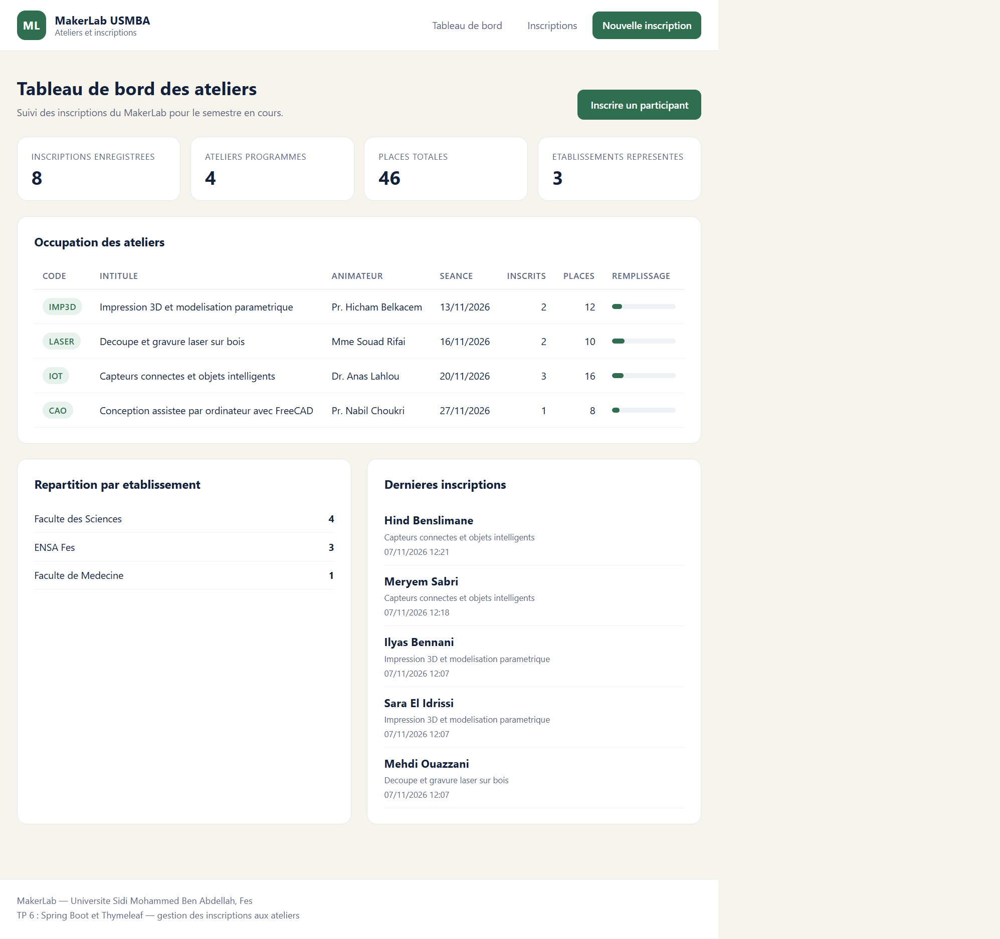

Vue d'ensemble après connexion à la base : 7 inscriptions réparties sur 4 ateliers, 3 établissements représentés et un taux d'occupation global de 17 %. Chaque atelier dispose d'une jauge qui se colore selon le remplissage, ce qui rend immédiatement visible celui qui risque d'être complet.

### 2. Liste des inscriptions

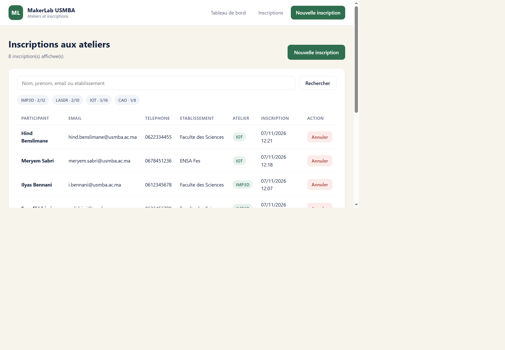

Le tableau affiche les inscriptions les plus récentes en premier. Chaque ligne présente le participant, son email, son téléphone, son établissement, l'atelier choisi et la date d'inscription. Les puces au-dessus du tableau rappellent l'occupation de chaque atelier et servent aussi de filtre.

### 3. Recherche plein texte

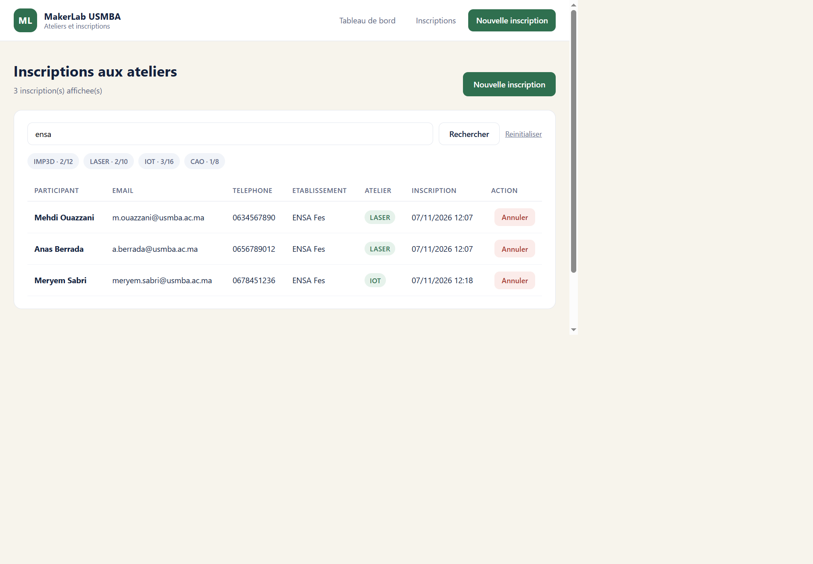

La recherche `ensa` remonte les trois participants inscrits depuis l'ENSA Fès. Le terme est cherché sans tenir compte de la casse sur quatre colonnes à la fois (nom, prénom, email, établissement) grâce à une méthode de requête dérivée du nom `Or...ContainingIgnoreCase`.

### 4. Filtre par atelier

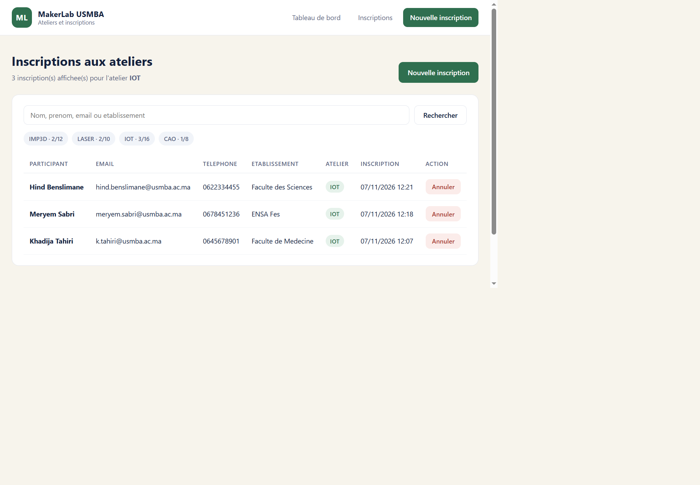

Le filtre sur l'atelier IOT isole ses trois inscrits. Le compteur en haut se met à jour (`3 inscription(s) affichée(s)`) et le titre rappelle le filtre actif : la même page sert donc de liste, de résultat de recherche et de vue filtrée.

### 5. Formulaire d'inscription

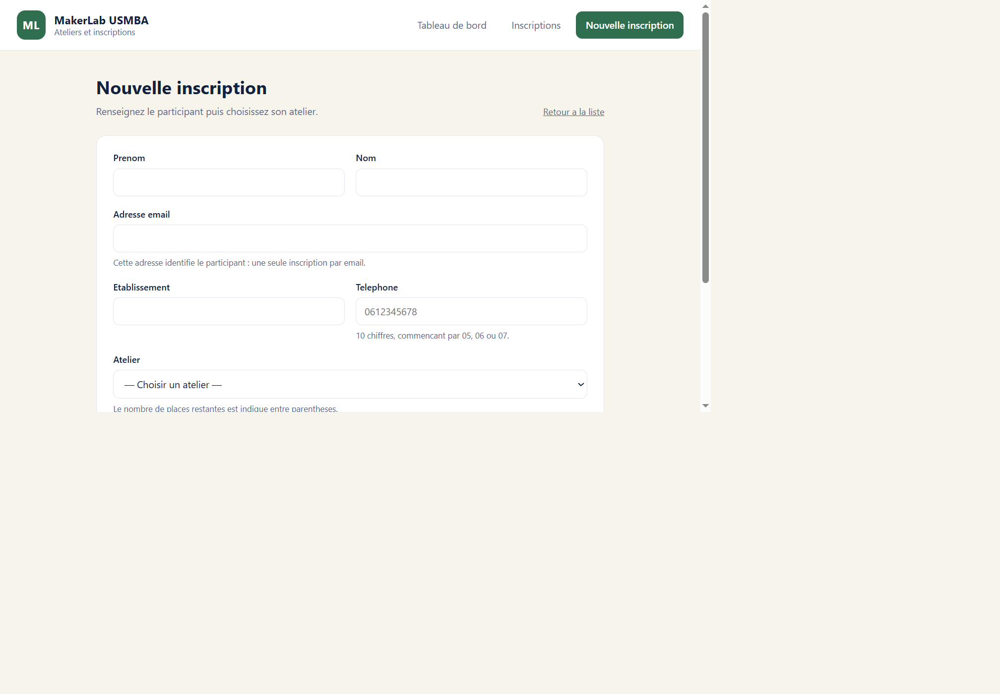

Le formulaire est construit avec `th:object` et `th:field`, ce qui permet à Spring de relier chaque champ au bean `Participant`. Le menu déroulant affiche les places disponibles entre parenthèses pour aider l'utilisateur à choisir un atelier encore ouvert.

### 6. Formulaire rempli

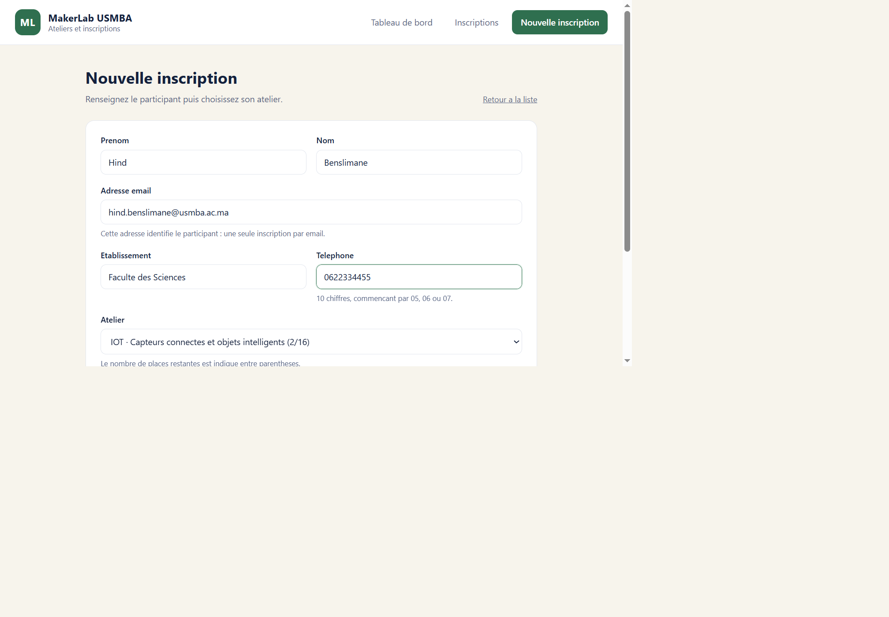

Saisie complète avant validation : le téléphone respecte le format marocain à 10 chiffres et l'atelier IOT est sélectionné. Le binding de la liste déroulante passe par un `Converter<String, Atelier>` maison, ce qui évite de manipuler des identifiants bruts dans le contrôleur.

### 7. Inscription enregistrée

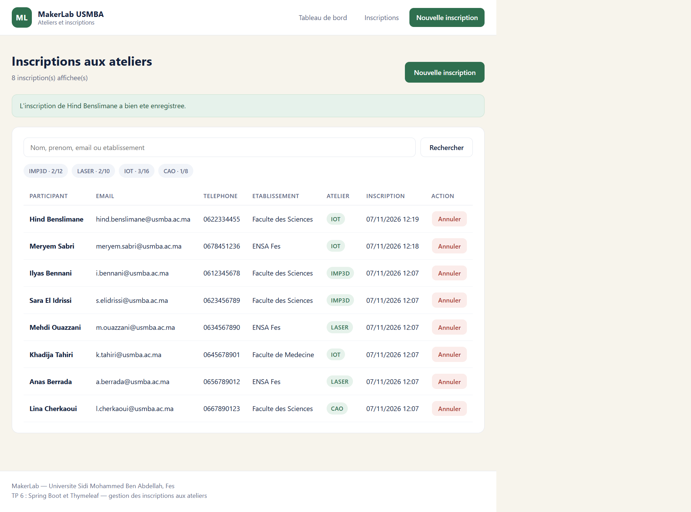

Après le `POST`, le contrôleur redirige vers `/inscriptions` (motif POST-Redirect-GET) et un bandeau de confirmation s'affiche. La nouvelle inscription apparaît en tête de tableau et le compteur de l'atelier IOT passe de 2 à 3.

### 8. Erreurs de validation

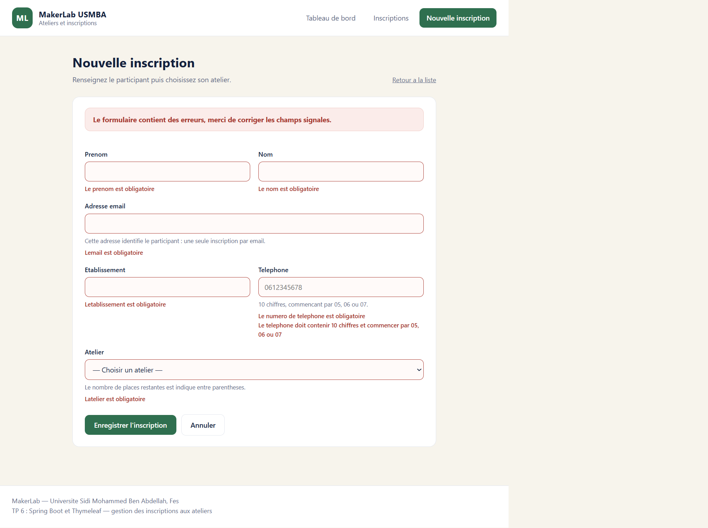

Soumission d'un formulaire vide : les six violations de contraintes sont affichées simultanément, chacune sous son champ. Le bloc d'alerte en haut du formulaire est produit par `#fields.hasAnyErrors()` et la liste détaillée par `#fields.errors('*')`, exactement comme demandé à l'étape 11 du TP.

### 9. Email déjà utilisé

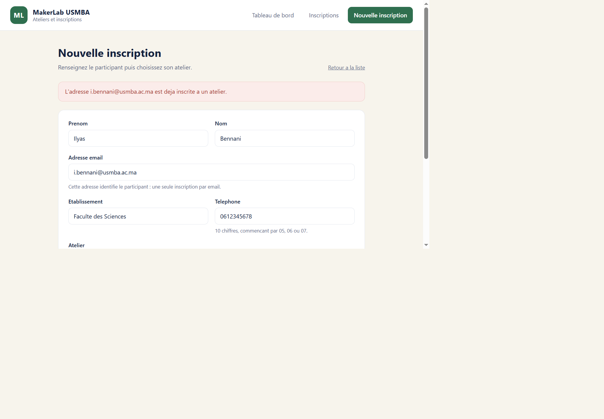

Une règle métier du service refuse deux inscriptions avec le même email. Le message est ajouté au `BindingResult` via `rejectValue`, donc il s'affiche comme une erreur de champ classique et les valeurs déjà saisies sont conservées.

### 10. Atelier complet

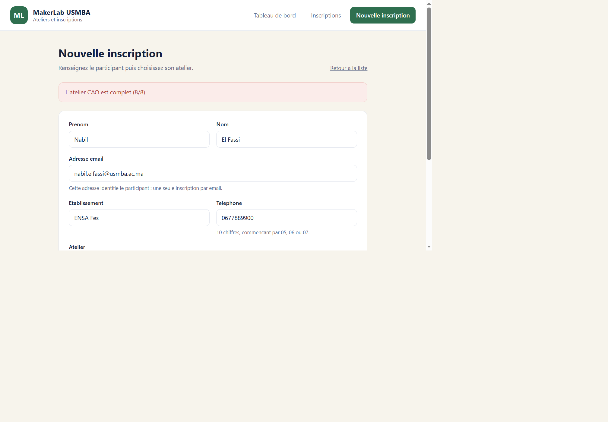

L'atelier CAO a été rempli jusqu'à sa capacité de 8 places : la tentative d'inscription est rejetée avec le message `L'atelier CAO est complet (8/8)`. La contrainte est vérifiée côté service, pas seulement côté interface.

### 11. Annulation d'une inscription

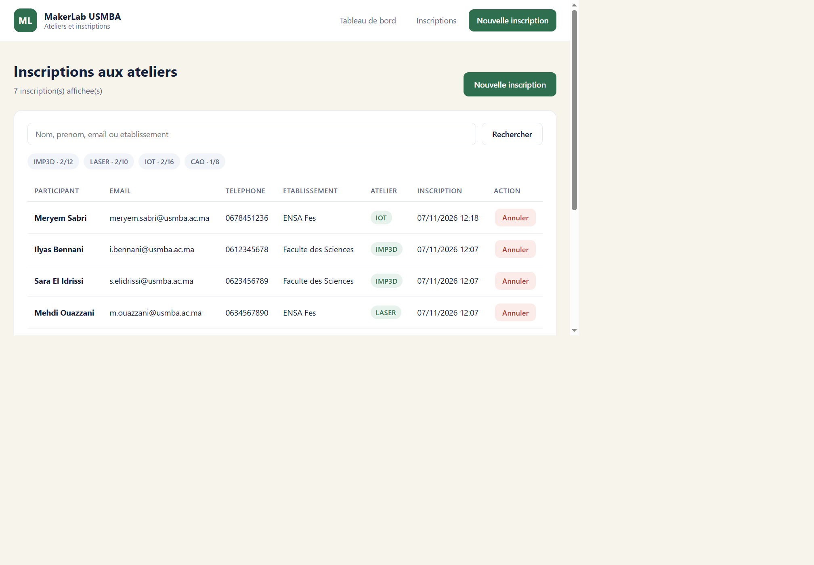

La suppression passe par un formulaire POST (jamais par un lien GET) et une confirmation JavaScript. Le message `L'inscription de ... a été annulée` confirme l'opération et le compteur de l'atelier est décrémenté en conséquence.

---


